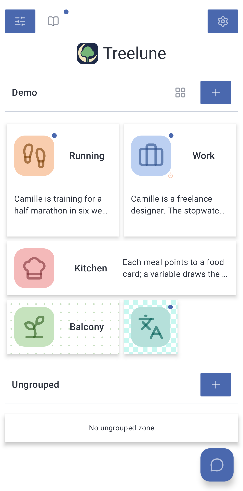
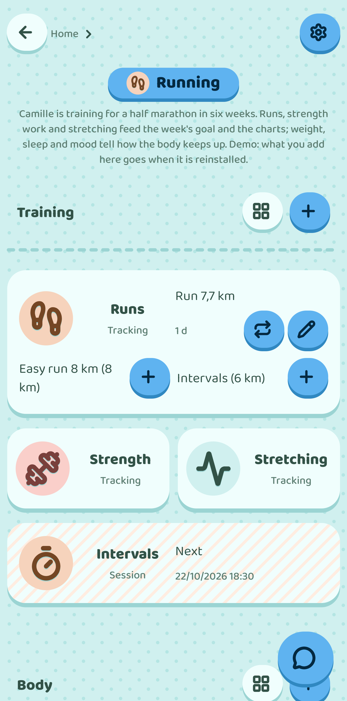
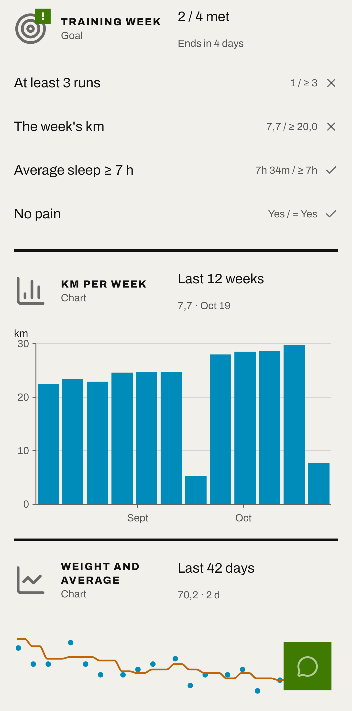
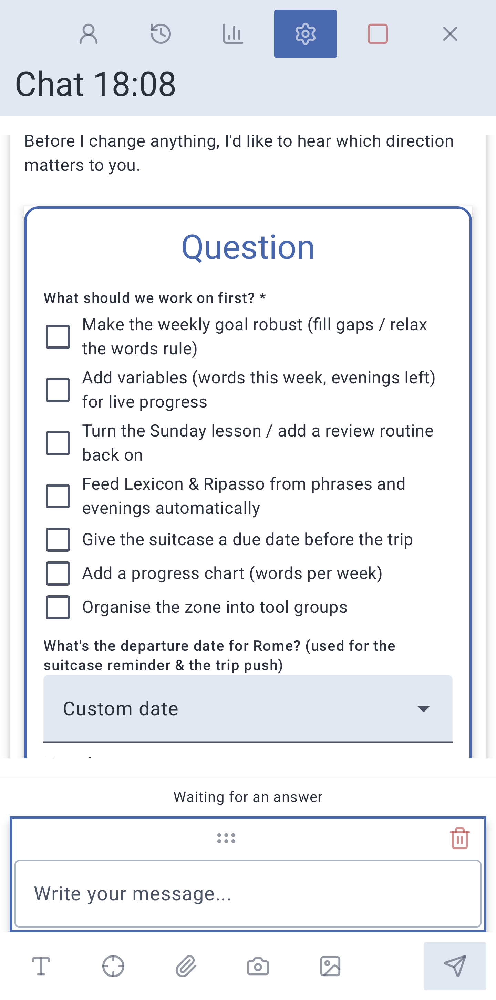

**English** · [Français](README.fr.md)

# Treelune

**Every tracking app does one thing, its own way. Treelune gives you the pieces, and you build the one you need.**

A tracker, a journal, a list, records, a goal, a chart, flashcards, a calendar… Each piece is set up your way, and they all fit together. What you note once is used everywhere: counted, compared, charted, reviewed.

- The vocabulary list becomes a flashcard deck.
- Meals draw on food records, and the day's calories add up by themselves.
- Work hours split by client, ready for the invoice.
- Each run moves the week's goal forward, and a curve shows how far you've come.
- Each evening's mood colours a calendar, month after month.

A free and open source Android app, with no account and no ads. The data stays on the phone.

The site, with the app at work: [treelune.app](https://treelune.app)

Treelune is still young, and has been tried on only a few phones. To get a problem fixed, report it from Settings › Report a bug.

<p>
  
  
  
  
</p>

## The pieces

### Zones and tools

Each part of your life becomes a **zone**: training, a project, a vegetable patch, a language, and whatever else you want to add. In each zone, you place the **tools** you need. Whatever you note in a tool, a weigh-in, a meal, a journal page, is one of its **entries**. The tool types:

<!-- tools -->
- **Tracking** — Numbers, ratings, choices or timed durations, noted as they come, such as weight, sleep, mood or glasses of water
- **Notes** — Notes, each with its title, kept where they belong
- **Journal** — A dated diary, for writing about your days
- **Messages** — Reminders and notifications, once or on a schedule
- **List** — What is left to do, checked off as it is done, with due dates if you want
- **Records** — The fields you choose, each record found by its name, for foods, books, plants or anything else
- **Goal** — A goal judged each day, week or month by the criteria you set, read from your entries
- **Questionnaire** — Questions asked one per screen, when you want or at planned times
- **Chart** — Your entries and figures drawn as lines, bars, pies or calendars
- **Session** — Steps prepared ahead, then followed on screen with a timer and a signal at each change, such as a workout or a recipe
- **Calendar** — Appointments and events at a time, which pass by themselves, with reminders
- **Flashcards** — Cards to review drawn from another tool, each coming back just before it is forgotten
<!-- /tools -->

Each tool can be set up: its fields, its units, its reminders, how it shows on the zone.

### What links them

A **variable** is a figure worked out from the entries, such as the day's calories or the week's kilometres. A Goal compares it to its target, a Chart draws it, the AI reads it. An entry can also **point** to another one, a meal to the food's sheet, a harvest to its plant.

### With an AI, if you want

An AI knows the same pieces you do. Ask it “set me up to train for a half marathon”, and it creates the zone, the tools and the links between them. It then reads the tools, adds entries to them, creates new ones and sets them up. Everything stays possible without AI.

- You talk to it in a conversation, attaching a tool or a zone in one gesture, over the period you care about.
- Before any change, you can require it to show what it is about to do and wait for your approval, for the whole app, a zone, a tool or a conversation.
- When it lacks some information, it asks you as a field to fill in.
- It can speak as an **identity**, with its own voice and character, created in the app or imported from a file, chosen for a zone, a routine or a conversation.
- With a **routine**, it works on its own, on a schedule: “every Sunday evening, sum up my week”. It can create routines too.
- An AI running elsewhere, such as Claude, ChatGPT or a free model on your computer with LM Studio, can also plug into the app as a connector, and work on the tools from there.

You bring your own API key, from one of these providers:

<!-- providers -->
**Claude**, **OpenAI**, **DeepSeek**
<!-- /providers -->

or from any service that speaks OpenAI's API (Ollama, LM Studio, OpenRouter…). The app shows what each exchange costs.

### Your way

You lay out each zone's tiles as you like, choose each tool's icon and colour, and the look of the whole app:

<!-- themes -->
- **Material** — Clear and sober, in the colour of your choice
- **Retro** — Pixel art: whole pixels, a drawn font, pixel icons, its own sounds
- **Cosy** — Like a phone in a gentle game: round and plump, everything bounces, its own sounds
- **Swiss** — Like a Swiss poster: a strict grid, black and white and a single red, the numbers large, its own sounds
- **Ink and wash** — Like an ink wash painting: cream paper, black ink and a single seal red, plenty of empty space, its own sounds
- **Metro** — Like metro signage: each tool a line in its colour, each zone a station, its own sounds
- **Cut paper** — Coloured sheets cut with scissors, laid askew on kraft paper, its own sounds
- **Blueprint** — Like an architect's blueprint: fine lines on grid paper, dimensions and hatching, its own sounds
- **E-reader** — Like an e-reader: pure black and white, patterns instead of greys, nothing that moves
<!-- /themes -->

## Getting started

Download the latest version's APK from the [releases page](https://github.com/badibam/treelune/releases), or build the app from source (see below). It is not on F-Droid yet.

On first launch, a **demo** is waiting: twelve weeks in the life of Camille, who trains for a half marathon, works freelance, cooks, grows things on her balcony and learns Italian before a trip to Rome. There you see what the app looks like once built. Then the **Guide** (the book at the top of the home screen) is followed step by step: the demo, a first zone, a first tool, then the AI and routines.

## Your data

- Everything is stored on the phone. No account, no telemetry, no ads.
- Nothing goes to an AI unless you asked for it: when you write to it, or when a scheduled routine runs. What goes then is sent only to the chosen provider, with your key, which is stored encrypted on the phone.
- To show what exchanges cost, the app downloads a public list of model prices (LiteLLM, on GitHub). It sends nothing.
- Once the connector is enabled, its exchanges go through an HTTPS relay whose address you give, or through Tailscale Funnel with your own Tailscale account.
- Everything is backed up and restored as one file, which the app copies after each change into a chosen folder.

## Project status

The app is in active development. It is used every day, but anything may still change, the shape of the data included. Keep backups.

<!-- status -->
- Version 0.9.2
- Android 8.0 or later
- A 64-bit phone (arm64)
- Languages: English, French
<!-- /status -->

## For developers

Kotlin, Jetpack Compose and Room. Everything that acts on the data — the interface, the AI, the scheduler — goes through one entry point, which gives the AI exactly the user's moves. A tool type is added without touching the app's core.

```bash
git clone https://github.com/badibam/treelune.git
cd treelune
./run            # the menu: build, install, test…
./run build      # the debug APK
```

The technical documentation starts at [`docs/reference.md`](docs/reference.md).

## Licence

[GPL-3.0-or-later](LICENSE), that is version 3 of the GNU General Public License, or any later version.
